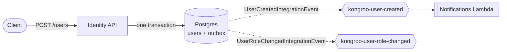

#  Kongroo.Identity

User registration, authentication, and JWT issuance microservice for FIAP Cloud Games.

## Endpoints

- `POST /users` — Register user
- `POST /tokens` — Authenticate and get JWT
- `GET /users/me` — Get authenticated user profile
- `GET /users` — List all users (Admin only)
- `GET /users/{id}` — Get user by ID (Admin only)
- `PUT /users/{id}/role` — Change user role (Admin only)
- `GET /health` — Health check
- `GET /metrics` — Prometheus metrics

## Messaging



On user registration the service publishes a `UserCreatedIntegrationEvent`, and on role changes a
`UserRoleChangedIntegrationEvent`, through MassTransit for downstream consumers (e.g. notifications).
Events are dispatched through a transactional outbox, so delivery is at-least-once and consumers must be
idempotent.

The transport is selected by `Messaging__Transport`: `RabbitMq` (default, used by Docker Compose and the
tests) or `AmazonSqs` (Kubernetes). With `Messaging__Transport=AmazonSqs` the bus publishes to SNS topics
`kongroo-user-created` and `kongroo-user-role-changed` (names fixed by `MessagingTopics`); the Notifications
Lambda subscribes to the first one. The Kubernetes manifests default to `AmazonSqs`, so the pod only becomes
Ready once the `aws-credentials` Secret (shipped and refreshed by Kongroo.Orchestration) holds live Learner Lab
credentials; set `Messaging__Transport=RabbitMq` in the ConfigMap to run the cluster against RabbitMQ instead.

## Environment Variables

| Variable                          | Source    | Description                                |
| --------------------------------- | --------- | ------------------------------------------ |
| `ConnectionStrings__Database`     | Secret    | PostgreSQL connection string               |
| `RabbitMq__Host`                  | ConfigMap | RabbitMQ broker hostname (e.g. `rabbitmq`) |
| `RabbitMq__User`                  | Secret    | RabbitMQ username                          |
| `RabbitMq__Pass`                  | Secret    | RabbitMQ password                          |
| `Jwt__Issuer`                     | ConfigMap | JWT issuer                                 |
| `Jwt__Audience`                   | ConfigMap | JWT audience                               |
| `Jwt__SigningKey`                 | Secret    | JWT signing key (min 32 chars)             |
| `Jwt__AccessTokenLifetimeMinutes` | ConfigMap | Token lifetime in minutes                  |
| `BootstrapAdmin__Username`        | ConfigMap | Admin account username                     |
| `BootstrapAdmin__Email`           | ConfigMap | Admin account email                        |
| `BootstrapAdmin__Password`        | Secret    | Admin account password                     |
| `BootstrapAdmin__Name`            | ConfigMap | Admin display name                         |
| `Messaging__Transport`            | ConfigMap | `RabbitMq` (default, compose/tests) or `AmazonSqs` (k8s) |
| `Aws__Region`                     | ConfigMap | AWS region for SQS/SNS when `AmazonSqs`    |
| `AWS_ACCESS_KEY_ID` / `AWS_SECRET_ACCESS_KEY` / `AWS_SESSION_TOKEN` | Secret `aws-credentials` | AWS SDK default credential chain |

## Observability

`GET /metrics` exposes OpenTelemetry metrics in Prometheus format (ASP.NET Core request duration by
route and status, HttpClient, .NET runtime, MassTransit publish/consume counters).

## Running Locally

Generate the local credentials (also sets this API's user-secrets) and start PostgreSQL and RabbitMQ
(from `Kongroo.Orchestration`):

```powershell
./scripts/new-secrets.ps1 -SkipKubernetes
docker compose up postgres rabbitmq -d
```

Then run the service:

```bash
dotnet run --project src/Kongroo.Identity
```

## Running Tests

Requires Docker — integration and BDD specs spin up PostgreSQL (and, for the specs, RabbitMQ) via Testcontainers. Unit tests need no Docker.

```bash
dotnet test
```

## Docker

```bash
dotnet restore
docker build -t kongroo-identity .
docker run -p 8080:8080 \
  -e ConnectionStrings__Database="<postgres-connection-string>" \
  -e RabbitMq__Host="localhost" \
  -e RabbitMq__User="kongroo" \
  -e RabbitMq__Pass="<rabbitmq-password>" \
  -e Jwt__SigningKey="<jwt-signing-key>" \
  kongroo-identity
```
